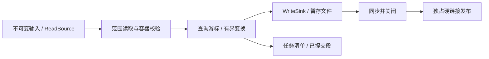

# 架构、所有权与提交边界

核心库处理 MCAP 0 容器和显式选择的消息解释规则；宿主负责文件、网络、时钟、
线程与持久化。模块和运行环境见 [支持范围](scope.md)。可核对的承诺清单在
[contracts.json](contracts.json)，`python tools/contract_audit.py` 只检查这些承诺能追溯到
现存实现和测试；实际执行结果由 [验证入口](verification.md) 提供。

| 层 | 实现 | 状态与责任 |
| --- | --- | --- |
| 记录解析与校验 | [source_scan.mbt](../source_scan.mbt)、[reader.mbt](../reader.mbt) | 按记录限制输入和解压；已观察消息不代表后续 CRC 已通过 |
| 选择性查询 | [range_reader.mbt](../range_reader.mbt)、[sidecar.mbt](../sidecar.mbt) | 缓存、候选块与游标状态；索引绑定源内容，快速查询不能替代全文件校验 |
| 流式编码 | [stream_writer.mbt](../stream_writer.mbt) | 声明、当前 Chunk、统计；finish 成功只说明 sink 接受完整容器，不等于文件已持久发布 |
| Node 文件宿主 | [files.mbt](../nodeio/files.mbt)、[storage.mbt](../nodeio/storage.mbt) | 文件描述符、短写重试、同步、独占发布与临时文件清理 |
| 录制与批次 | [recording_session.mbt](../recording_session.mbt)、[artifact_batch.mbt](../artifact_batch.mbt) | 清单校验、已提交产物复用、未提交部分恢复；没有多系统事务或断电保证 |
| 可选异步与工具 | [异步 IO](async-io.md)、[配方](recipes.md) | IO、线程池、输入/代码/运行时指纹；具体资源按对应入口显式关闭 |

## 文件发布状态

`output_transaction` 创建独占暂存文件。写入与同步完成后，硬链接创建目标路径，
这是可见性的提交点。目标存在时拒绝覆盖；失败时也不会切换为覆盖写入。

1. 提交点之前失败：目标路径不存在，尽力关闭和清理本次拥有的暂存文件。
2. 硬链接成功：目标已包含完整内容。
3. 提交之后清理失败：返回包含 `output published` 的错误，完整目标可能存在，
   也可能残留同一内容的暂存硬链接。`abort` 不回滚或删除已发布目标。

这一区分由 [文件系统故障测试](../tools/fs_fault_workflows.py) 实际注入 ENOSPC、
短写/零进度、fsync、close、link 和 unlink 错误验证。测试不能证明断电、网络盘或
损坏硬件上的目录持久性；文件系统需支持同目录硬链接。

## 资源与错误传播

核心的 `ReadSource` / `WriteSink` 是能力回调，不接管自定义宿主资源。
调用方在成功、失败和取消路径上都负责关闭自己创建的文件/线程池/目录句柄。
Node 文件作用域会统一管理其打开的输入；自定义 sink 写入回调必须完整接受字节或抛错。
发生写错后丢弃该次未提交输出，不能继续向已经失败的容器追加。

查询游标的结束、取消与宿主资源关闭是不同动作。提前终止消费应取消游标，
再关闭源文件/HTTP 对象和工作线程池；取消在读取/记录边界检查，不抢占正在解压的计算。

## 磁盘格式演进

| 格式 | 0.17.2 的验证边界 | 不兼容时处理 |
| --- | --- | --- |
| MCAP 0 | 标准容器；旧发布包生成的合成文件可读 | 不支持的结构/版本或 CRC 错误明确拒绝 |
| MIDX1 / MIDX2 | 0.17.1 冻结侧车在源指纹一致时可读 | 源改变重新建索引；未知版本拒绝 |
| MRSC1 | 0.17.1 录制清单和已提交段可以恢复 | 参数、身份、校验不符拒绝；保留原目录检查 |
| ABAT1 | 0.17.1 已完成批次可以重复恢复且不重做 | plan 或产物不符拒绝；新计划用新目录 |
| MLIV1 | 0.17.1 快照在输入身份相同时可继续检查 | 身份不符拒绝；新输入建立新监视 |
| 配方及排序任务 | 遵守各任务的格式和身份合同 | 代码/规则/环境改变可能有意拒绝恢复，不能据此推导所有任务可跨版本续跑 |

旧产物来自独立安装的 `LilaLola67/moonmcap@0.17.1`，生成器、编译器和逐文件
SHA-256 记录在 [冻结清单](../tests/fixtures/v0.17.1/manifest.json)。测试只操作副本，
不会用新实现重生成旧产物来伪造兼容证据；未知未来版本与身份不符也有拒绝案例。
